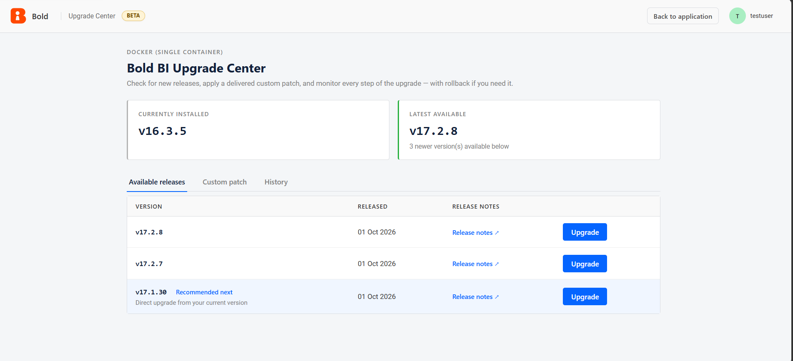
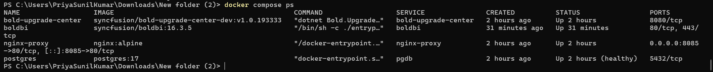
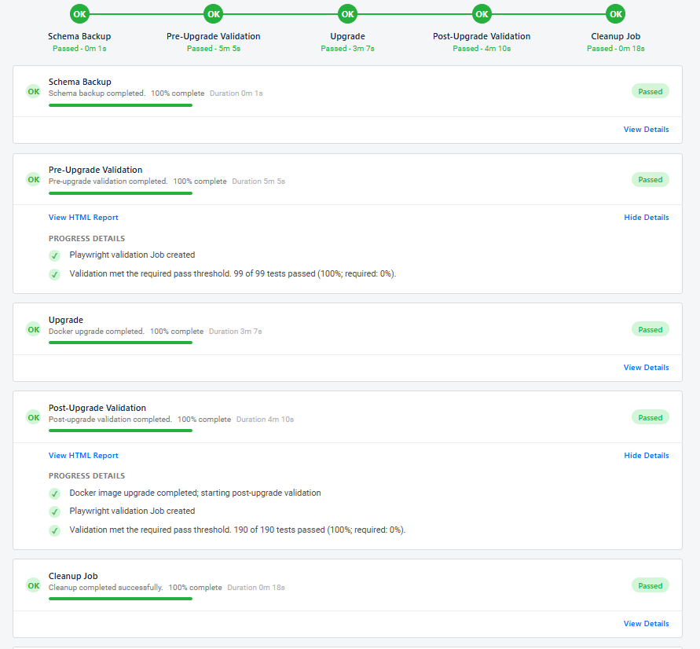
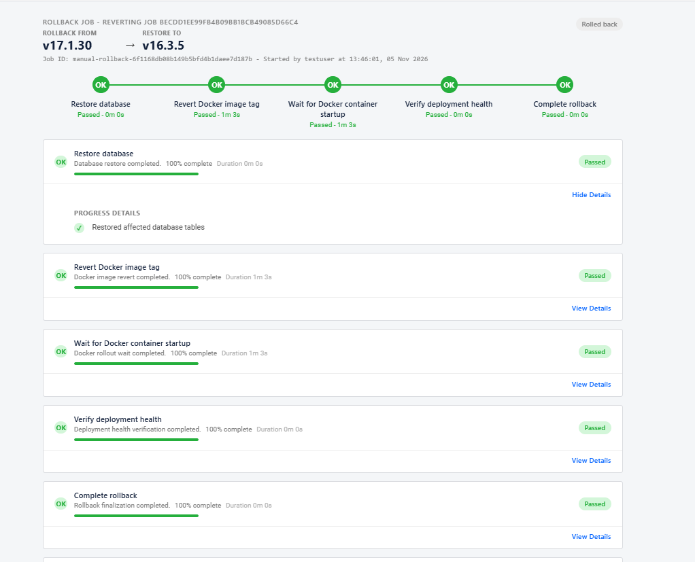

# Upgrade Center Deployment Guide for Bold BI (Docker)

## Overview

The **Upgrade Center** is a dedicated upgrade management service that enables administrators to upgrade an existing **Bold BI Docker deployment** directly from the application interface.

Instead of manually downloading Docker images, updating containers, and validating the environment, administrators can perform the entire upgrade from within Bold BI.



### Key Benefits

With Upgrade Center, administrators can:

- Check for available Bold BI updates.
- Upgrade Bold BI directly from the administration portal.
- Validate the environment before and after upgrades.
- Automatically back up database objects when schema changes are required.
- Automatically roll back to the previous version if an upgrade fails.
- Review upgrade logs and validation results.

> **Note**
>
> Only users with **Bold BI Administrator** privileges can access and perform upgrades through Upgrade Center.


# Architecture Overview

The deployment consists of the following containers:

| Container | Purpose |
|-----------|---------|
| `boldbi` | Bold BI application |
| `postgres` | Bold BI database (when deployed using the sample compose files) |
| `bold-upgrade-center` | Manages upgrade operations and validation |
| `nginx-proxy` | Routes requests to Bold BI and Upgrade Center |



# How Upgrade Center Works

When an upgrade is initiated, Upgrade Center automatically performs the following actions:

1. Detects the currently installed Bold BI version.
2. Retrieves available versions from the release service.
3. Creates database backups if schema updates are required.
4. Runs pre-upgrade validation tests.
5. Upgrades the Bold BI container.
6. Performs application health checks.
7. Runs post-upgrade validation tests.
8. Cleans up temporary validation data.
9. Completes the upgrade or automatically rolls back if validation fails.




# Prerequisites

Before deploying Upgrade Center, ensure the following requirements are met.

## Bold BI Deployment

- An existing and running **Bold BI Docker deployment**.
- The Bold BI container must be named:

```text
boldbi
```

If you are using a different container name, update the following setting accordingly:

```text
UpgradeCenter__Docker__ContainerName
```


## Docker Requirements

- Docker Engine must be installed and running.
- Docker socket must be accessible:

```text
/var/run/docker.sock
```

- The Bold BI container, Upgrade Center container, and proxy container must be connected to the same Docker network.


## Security Considerations

Upgrade Center requires access to the Docker socket:

```yaml
/var/run/docker.sock:/var/run/docker.sock
```

This allows Upgrade Center to:

- Pull Docker images.
- Stop and start containers.
- Create replacement containers.
- Run validation containers.
- Perform rollback operations.

> **Important**
>
> Access to the Docker socket grants administrative-level control over Docker on the host machine. Restrict Upgrade Center access to trusted administrators only.


# Docker Compose Configuration

Add the following services to your existing `docker-compose.yml`.

## Upgrade Center Service

```yaml
bold-upgrade-center:
  image: syncfusion/bold-upgrade-center:<version>
  container_name: bold-upgrade-center
  user: "0:0"
  restart: unless-stopped

  depends_on:
    - boldbi

  environment:
    UPGRADE_CENTER_DEPLOYMENT_ENV: "Docker"
    BOLD_ADMIN_USERNAME: "<admin-user>"
    BOLD_ADMIN_PASSWORD: "<admin-password>"

  volumes:
    - /var/run/docker.sock:/var/run/docker.sock
    - boldbi_data:/application/app_data:ro
    - uc_data:/app/App_Data
    - bold-upgrade-center-playwright-state:/app/playwright-shared-state

  networks:
    - boldbi
```


## Nginx Proxy Service

```yaml
nginx-proxy:
  image: nginx:alpine
  container_name: nginx-proxy
  restart: unless-stopped

  ports:
    - "8085:80"

  depends_on:
    - boldbi
    - bold-upgrade-center

  networks:
    - boldbi

  volumes:
    - ./boldbi-nginx-config.conf:/etc/nginx/conf.d/default.conf:ro
```


## Nginx Configuration

Create a file named:

```text
boldbi-nginx-config.conf
```

Add the following configuration:

```nginx
server {
    listen 80;

    location /upgrade-center {

        proxy_pass http://bold-upgrade-center:80;

        proxy_set_header Host $http_host;
        proxy_set_header X-Forwarded-Host $http_host;
        proxy_set_header X-Forwarded-Port $server_port;
        proxy_set_header X-Forwarded-Proto $scheme;
        proxy_set_header X-Forwarded-For $proxy_add_x_forwarded_for;
    }

    location / {

        proxy_pass http://boldbi:80;

        proxy_set_header Host $http_host;
        proxy_set_header X-Forwarded-Host $http_host;
        proxy_set_header X-Forwarded-Port $server_port;
        proxy_set_header X-Forwarded-Proto $scheme;
        proxy_set_header X-Forwarded-For $proxy_add_x_forwarded_for;

        proxy_redirect off;
    }
}
```

## Networks and Volumes

```yaml
networks:
  boldbi:

volumes:
  boldbi_data:
  db_data:
  uc_data:
  bold-upgrade-center-playwright-state:
```


# Volume Configuration

| Volume | Container Path | Purpose |
|----------|----------|----------|
| `boldbi_data` | `/application/app_data` | Stores Bold BI application configuration, encryption keys, and product data |
| `uc_data` | `/app/App_Data` | Stores Upgrade Center data, validation reports, and application state |
| `bold-upgrade-center-playwright-state` | `/app/playwright-shared-state` | Stores Playwright authentication sessions and validation state |


# Playwright Validation

Upgrade Center uses Playwright runner containers to automate upgrade validation.

The validation workflow includes:

- Pre-upgrade validation
- Post-upgrade validation
- Cleanup verification

During an upgrade:

1. The required Playwright runner image is retrieved automatically.
2. The runner container is attached to the Bold BI Docker network.
3. Validation tests are executed against the target environment.
4. Reports and results are uploaded back to Upgrade Center.


# Deployment Steps

## Step 1: Verify Existing Deployment

Verify that the Bold BI container is running:

```bash
docker ps --filter name=boldbi
```

Verify Docker volumes:

```bash
docker volume ls
```

Verify Docker networks:

```bash
docker network ls
```


## Step 2: Update Docker Compose

Add the following:

- Upgrade Center service
- Nginx proxy service
- Required volumes
- Docker network configuration

Place the Nginx configuration file in the same directory as `docker-compose.yml`.


## Step 3: Remove Existing Port Mapping

If Bold BI exposes ports directly, remove the configuration.

Example:

```yaml
ports:
  - "8080:80"
```

Nginx will serve as the single public entry point.


## Step 4: Start the Services

Deploy the updated stack:

```bash
docker compose up -d
```

Monitor Upgrade Center logs:

```bash
docker compose logs -f bold-upgrade-center
```


## Step 5: Access Upgrade Center

Open the following URL in your browser:

```text
http://<server-host>:8085/upgrade-center
```

Sign in using a Bold BI administrator account.


## Step 6: Perform an Upgrade

1. Open Upgrade Center.
2. Review available versions.
3. Select the target version.
4. Start the upgrade process.
5. Monitor validation and upgrade progress.
6. Review upgrade results upon completion.


# Automatic Rollback

If any of the following checks fail:

- Database migration
- Container replacement
- Application health check
- Validation tests

Upgrade Center automatically:

1. Restores the previous Docker image.
2. Restores backed-up database objects.
3. Returns the environment to its original working state.

This minimizes downtime and reduces upgrade risk.




# Best Practices

- Create a full backup before performing major upgrades.
- Restrict Upgrade Center access to trusted administrators.
- Keep Docker Engine updated.
- Ensure adequate disk space is available before starting an upgrade.
- Test upgrades in a staging environment before upgrading production systems.
- Store administrator credentials securely and never commit them to source control.
